# Email Manager v3.0.0 · 程序完整流程图

> 依据 **v3.0.0** 源码（commit `45ed398`，Graph-only 后端）绘制。
> 源文件就是本 Markdown：GitHub / VS Code / Typora 可直接渲染 Mermaid。
> 本地可视化版：双击同目录的 `flowchart.html`（离线可用），由 `build-flowchart-html.py` 生成。

## 目录

1. [总体架构](#1-总体架构)
2. [启动与初始化](#2-启动与初始化)
3. [登录与凭据缓存](#3-登录与凭据缓存)
4. [自动监听：调度与一轮工作](#4-自动监听调度与一轮工作)
5. [启动补分类](#5-启动补分类)
6. [分类流水线](#6-分类流水线)
7. [AI 调用层](#7-ai-调用层)
8. [总结报告](#8-总结报告)
9. [监听状态机与基线推进](#9-监听状态机与基线推进)
10. [失败与退避](#10-失败与退避)
11. [数据与文件](#11-数据与文件)
12. [构建 / 运行 / 发布入口](#12-构建--运行--发布入口)
13. [附录 A：关键常量](#附录-a关键常量)
14. [附录 B：失败语义速查](#附录-b失败语义速查)

---

## 1. 总体架构

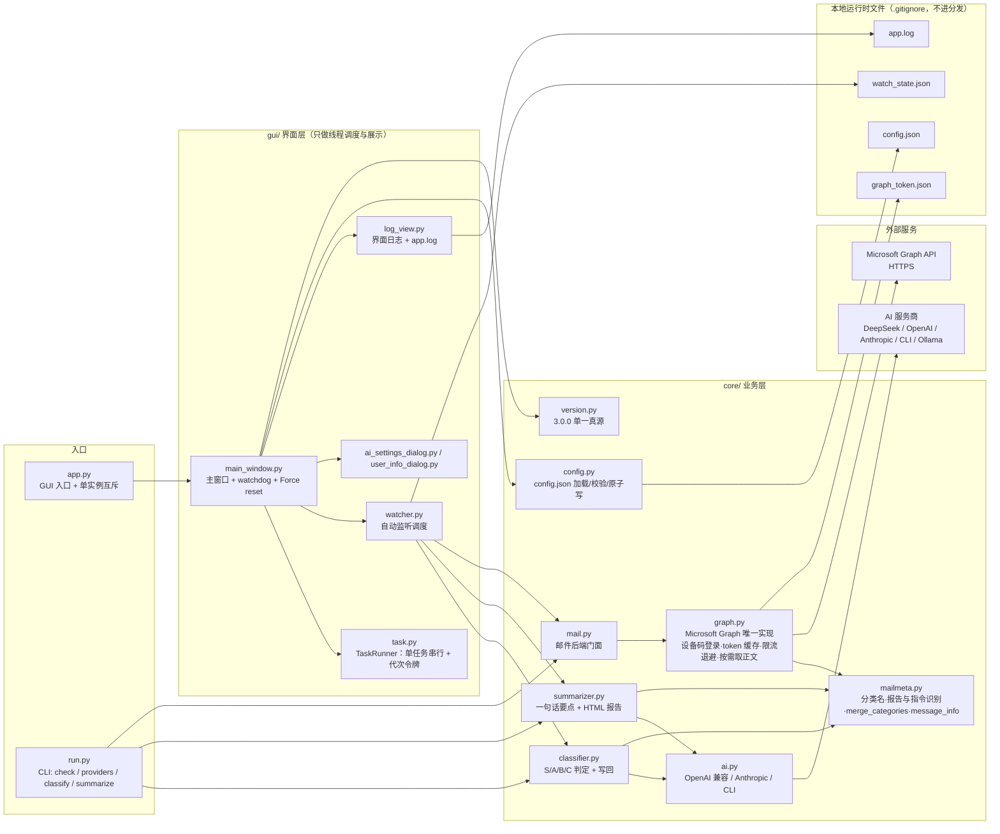

---

## 2. 启动与初始化

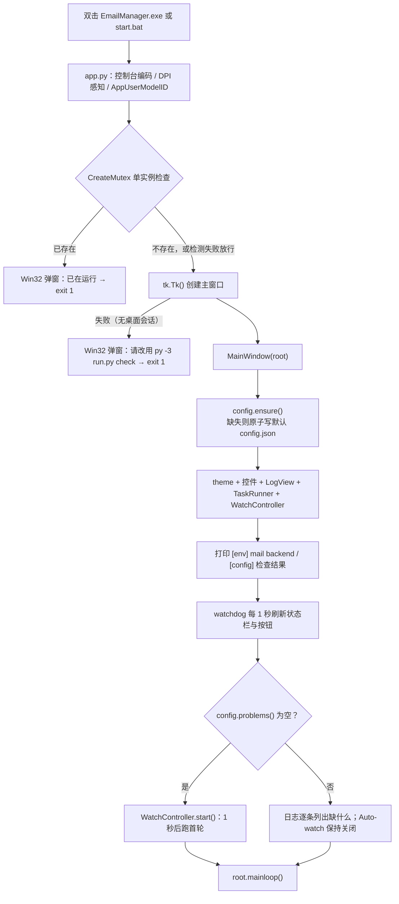

---

## 3. 登录与凭据缓存

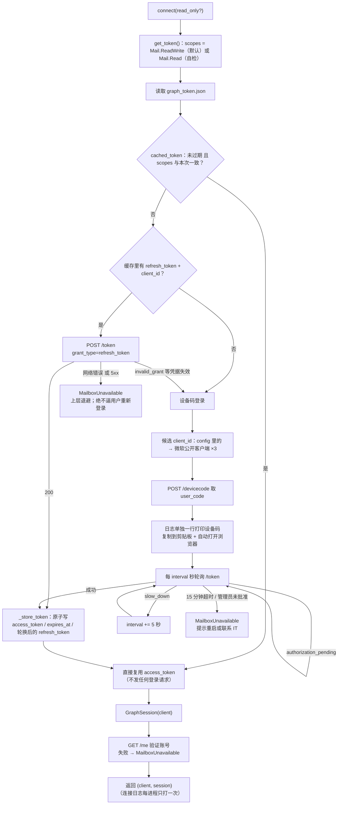

---

## 4. 自动监听：调度与一轮工作

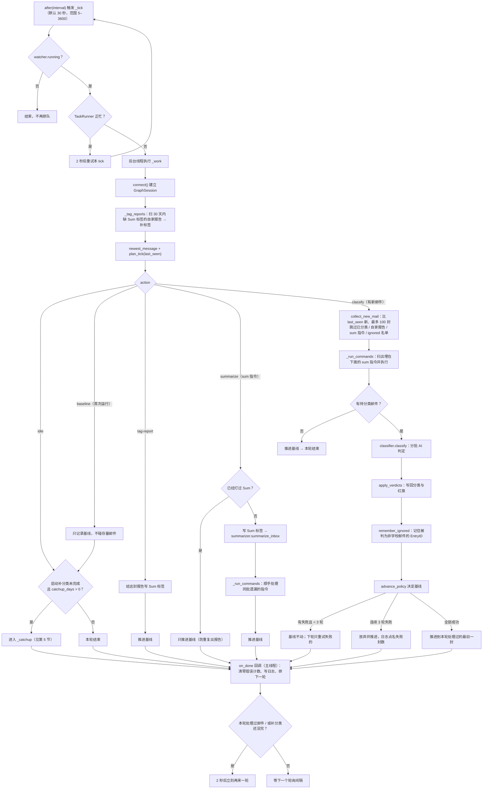

---

## 5. 启动补分类

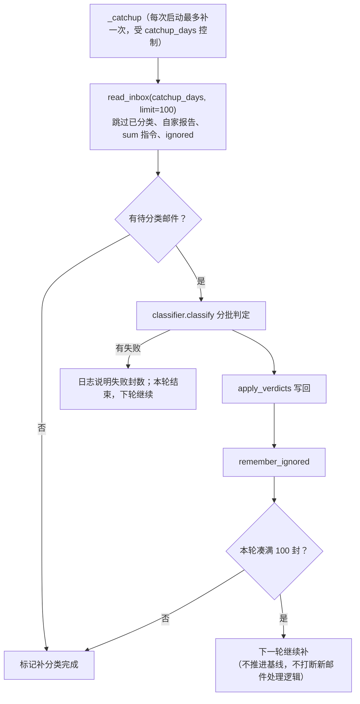

---

## 6. 分类流水线

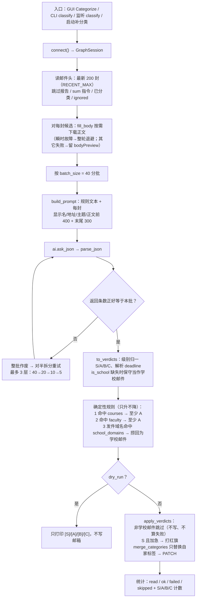

---

## 7. AI 调用层

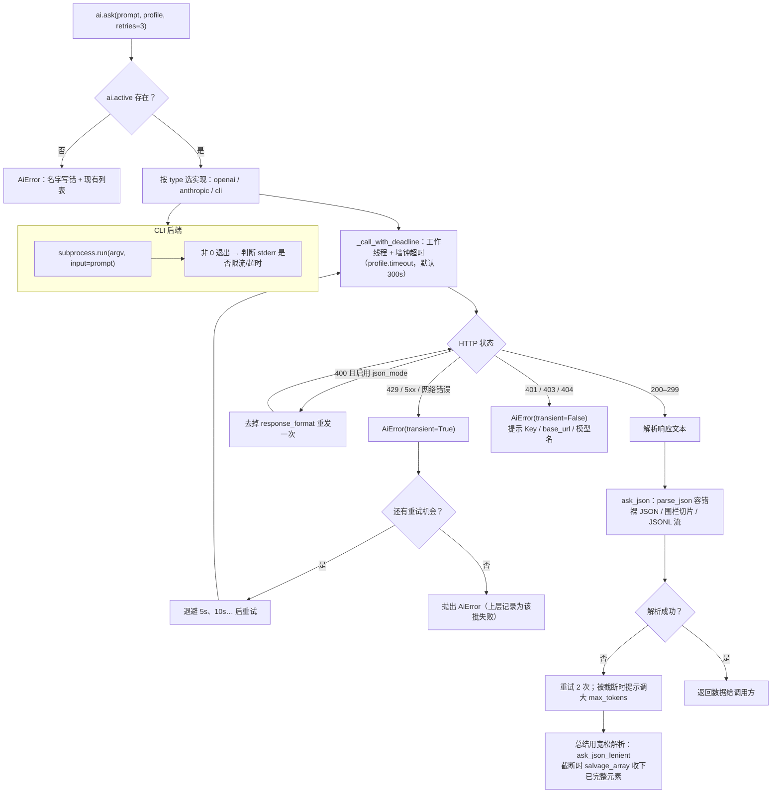

---

## 8. 总结报告

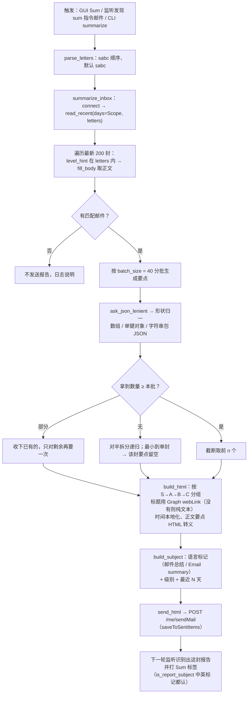

### 6.1 一次 GUI 分类的时序（补充）

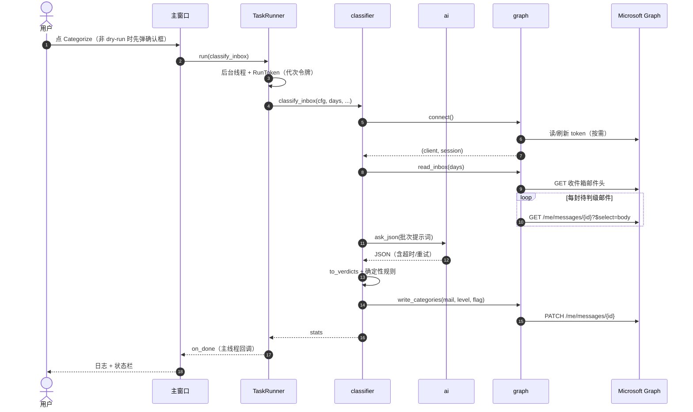

---

## 9. 监听状态机与基线推进

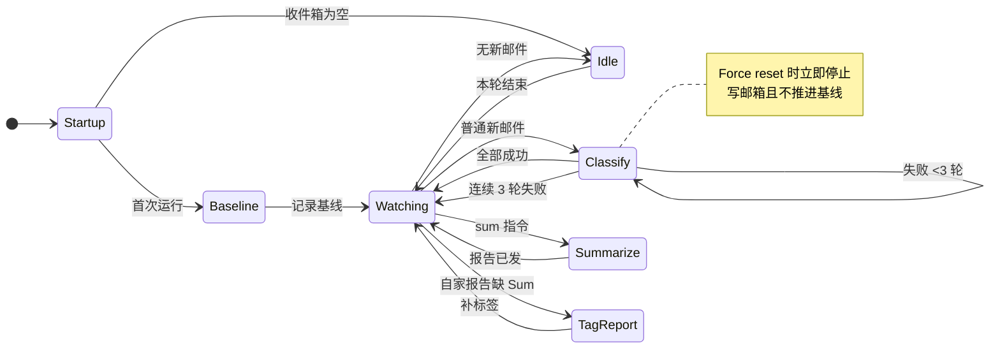

---

## 10. 失败与退避

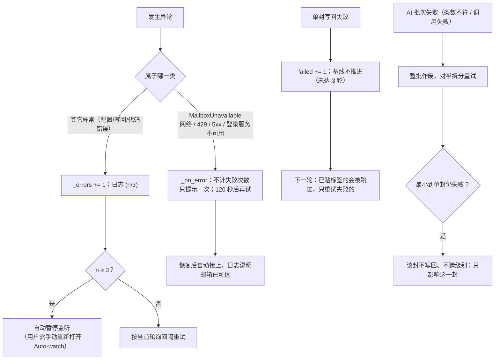

---

## 11. 数据与文件

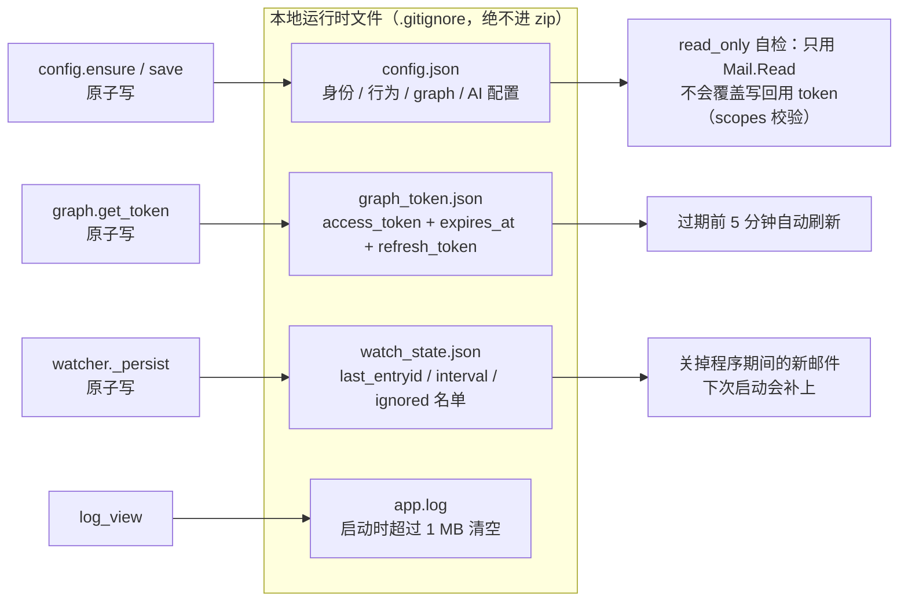

---

## 12. 构建 / 运行 / 发布入口

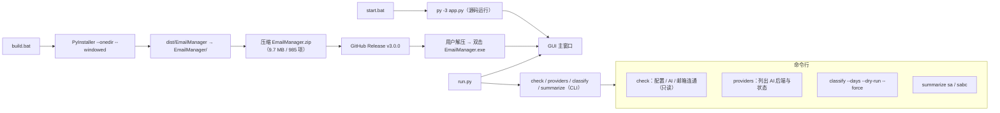

---

## 附录 A：关键常量

| 常量 | 值 | 作用 |
|---|---|---|
| `DEFAULT_INTERVAL` | 30 s | 监听轮询间隔（可调 5–3600） |
| `MAX_MAIL_PER_ROUND` | 100 | 一轮最多处理的邮件数 |
| `CATCHUP_DAYS` | 7 天 | 启动补分类 / 新邮件回溯窗口 |
| `MAX_FAILED_ROUNDS` | 3 | 同一批连续失败几轮后放弃推进 |
| `MAX_CONSECUTIVE_ERRORS` | 3 | 连续错误多少次自动暂停监听 |
| `MAILBOX_RETRY_DELAY` | 120 s | 邮箱不可用时的退避 |
| `REPORT_TAG_DAYS` | 30 天 | 补 Sum 标签的回溯窗口 |
| `RECENT_MAX` | 200 | 一次读取的邮件头上限 |
| `RECENT_TTL` | 10 s | 同一轮内查询结果复用的时长 |
| `TOKEN_MARGIN` | 300 s | access_token 提前刷新余量 |
| `MAX_ATTEMPTS` | 3 | Graph GET 限流/5xx 的最大尝试次数 |
| `batch_size` | 40 | 每次送 AI 的邮件数（config 可改） |
| `BODY_CHARS` / `BODY_TAIL_CHARS` | 400 / 300 | 判级时送给模型的正文头/尾字符数 |
| `BODY_CHARS`（总结） | 800 | 生成一句话要点时的正文长度 |
| `urgent_days` | 14 天 | S 级「截止在 N 天内」阈值 |
| `summary_days` | 7 天 | 总结报告默认回溯窗口 |
| `SPLIT_MIN` / `SPLIT_MAX_DEPTH` | 2 / 3 | 批次失败拆分的最小批量 / 最大层数 |

## 附录 B：失败语义速查

| 场景 | 行为 |
|---|---|
| 模型返回条数与请求不符 | **整批作废**，对半拆分重试；绝不错位贴标签 |
| 非学校邮件 | 不写回、不计失败；EntryID 记入 `watch_state.json` 的 ignored |
| 单封写回失败 | 计失败；基线不推进（< 3 轮），下轮只重试失败的 |
| 连续 3 轮失败 | 放弃并推进基线，日志点名，避免无限重试烧 AI 额度 |
| 监听基线推进 | 只在「本轮真的处理完」后推进；Force reset 中断则不推进 |
| 邮箱不可用（网络/429/5xx） | 不计失败、不暂停；120 秒退避后自动重连 |
| 断网 | 不触发重新登录（只有 refresh token 真的失效才走设备码） |
| 写回范围 | 只替换程序自己的标签（S/A/B/C/Sum）；用户分类与服务器规则分类保留 |
| 分类主列表 | **从不创建、删除、读取**；S/A/B/C/Sum 直接写在邮件上 |
| 报告邮件 | 靠主题标记识别并打 Sum，自己不会被再分类 |
